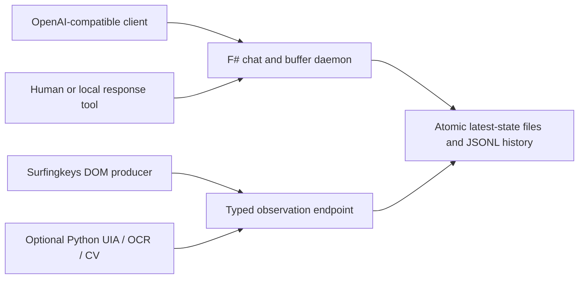

# OpenAI Buffer Daemon

A small F# localhost harness for inspecting OpenAI-compatible chat requests and fulfilling them through a manual JSON buffer. The same process accepts typed, read-only observations from browser and desktop perception producers.

This project is not a model server and is not affiliated with OpenAI. It preserves incoming chat JSON, exposes pending requests, and waits for a deliberate response at `/v1/buffer`.

## Architecture



The daemon is the transport boundary. Vision producers cannot click, type, or execute actions.

## Requirements

- .NET 10 SDK
- `uv` and Python 3.12+ for `optional_vision`
- Bun only when checking the Surfingkeys integration
- Optional native Tesseract executable for OCR

## Quick Start

```powershell
git clone <repository-url>
cd openai-buffer-daemon
./scripts/Build.ps1
./scripts/Start.ps1
```

The default base URL is `http://127.0.0.1:5087`. Runtime files default to the current user's Desktop; set a different location with `-DataDirectory`.

```powershell
./scripts/Start.ps1 -Url http://127.0.0.1:5091 -DataDirectory "$env:TEMP/openai-buffer-daemon"
```

## Manual Chat Flow

Start a waiting request in one terminal:

```powershell
$body = @{ model = 'manual-buffer-model'; messages = @(@{ role = 'user'; content = 'Hello' }) } | ConvertTo-Json -Depth 20
Invoke-RestMethod http://127.0.0.1:5087/v1/chat/completions -Method Post -ContentType application/json -Body $body
```

Fulfill it from another terminal:

```powershell
Invoke-RestMethod http://127.0.0.1:5087/v1/buffer -Method Post -ContentType application/json -Body '{"content":"Hello from the buffer."}'
```

`/v1/buffer` may receive a simple `content` value or a complete response containing `choices`. A `request_id` targets a particular pending request; otherwise the oldest pending request is completed.

## Endpoints

| Method | Path | Behavior |
| --- | --- | --- |
| `GET` | `/health` | Process and queue health |
| `GET` | `/v1/models` | Local compatibility model |
| `POST` | `/v1/chat/completions` | Wait for a buffer response; SSE supported |
| `GET/POST` | `/v1/buffer` | Inspect or fulfill the pending queue |
| `GET` | `/v1/pending` | Pending request metadata |
| `GET` | `/v1/requests/latest` | Latest untouched request |
| `GET` | `/v1/vision/schema` | Bundled observation schema |
| `GET/POST` | `/v1/vision/observations` | Observation status or ingestion |
| `GET` | `/v1/vision/observations/latest` | Latest accepted observation |

Other common `/v1` POST routes are logged compatibility stubs and return `501`; the daemon does not falsely claim those capabilities.

## Optional Vision

```powershell
uv sync --project optional_vision --extra all --group dev
uv run --project optional_vision buffer-vision doctor
uv run --project optional_vision buffer-vision observe --cv --output observation.json --overlay observation.png
uv run --project optional_vision buffer-vision observe --cv --post
```

The preference order is DOM, UI Automation, OCR, then generic CV geometry. See [optional_vision/README.md](optional_vision/README.md) and [docs/ARCHITECTURE.md](docs/ARCHITECTURE.md).

## Test

```powershell
./scripts/Test-All.ps1
```

This builds F#, runs Python unit and schema tests, and proves the chat/buffer and observation handshakes against a temporary live daemon.

## License

AGPL-3.0-only. See [LICENSE](LICENSE).
