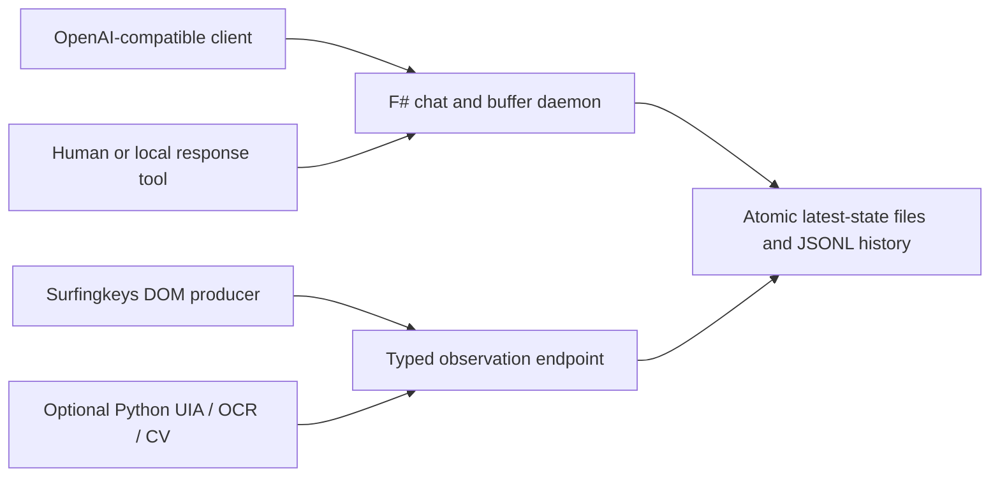

# OpenAI Buffer Daemon


A small F# localhost harness for inspecting OpenAI-compatible chat requests and fulfilling them through a manual JSON buffer. The same process accepts typed, read-only observations from browser and desktop perception producers.

This project is a fun take on a model server. It preserves incoming chat JSON, exposes pending requests, and waits for a deliberate response at `/v1/buffer`.

Dependencies:

- Tasket Communication Daemon at [CommanderTurtle/macrohelp](https://github.com/CommanderTurtle/macrohelp) : Macro HTTPD
- Dangerously greppable markdown files at [CommanderTurtle/regedited](https://github.com/CommanderTurtle/regedited) : Zone'd ripgrep sorted by index

## Architecture



The daemon is the transport boundary. Vision producers cannot click, type, or execute actions.
Separate opt-in perception pipes call an already running NInfer model or a cold
OCR helper; the original manual chat/buffer flow is unchanged.

## Requirements

- .NET 10 SDK
- `uv` and Python 3.12+ for `optional_vision`
- Bun only when checking the Surfingkeys integration
- Optional native Tesseract executable for OCR

## Quick Start

```powershell
git clone https://github.com/CommanderTurtle/firebending.git
cd firebending
./scripts/Build.ps1 -SkipVision
./scripts/Start.ps1
```

The default base URL is `http://127.0.0.1:5087`. Runtime files default to the current user's Desktop (or local application data on a headless host); set a different location with `-DataDirectory`. The daemon and the new Markdown endpoints need only .NET; vision and MCP remain optional.

```powershell
./scripts/Start.ps1 -Url http://127.0.0.1:5091 -DataDirectory "$env:TEMP/openai-buffer-daemon"
```

## Manual Chat Flow

Start a waiting request in one terminal:

```powershell
$body = @{ model = 'manual-buffer-model'; messages = @(@{ role = 'user'; content = 'Hello' }) } | ConvertTo-Json -Depth 20
Invoke-RestMethod http://127.0.0.1:5087/v1/chat/completions -Method Post -ContentType application/json -Body $body
```

Fulfill it from another terminal:

```powershell
Invoke-RestMethod http://127.0.0.1:5087/v1/buffer -Method Post -ContentType application/json -Body '{"content":"Hello from the buffer."}'
```

`/v1/buffer` may receive a simple `content` value or a complete response containing `choices`. A `request_id` targets a particular pending request; otherwise the oldest pending request is completed.

## Endpoints

| Method | Path | Behavior |
| --- | --- | --- |
| `GET` | `/health` | Process and queue health |
| `GET` | `/v1/models` | Local compatibility model |
| `POST` | `/v1/chat/completions` | Wait for a buffer response; SSE supported |
| `GET/POST` | `/v1/buffer` | Inspect or fulfill the pending queue |
| `GET` | `/v1/pending` | Pending request metadata |
| `GET` | `/v1/requests/latest` | Latest untouched request |
| `GET` | `/v1/vision/schema` | Bundled observation schema |
| `GET/POST` | `/v1/vision/observations` | Observation status or ingestion |
| `GET` | `/v1/vision/observations/latest` | Latest accepted observation |
| `POST` | `/v1/macro` | Replace the persistent Tasket `.scht` pointer or set it to `off` |
| `POST` | `/v1/rgd1` ... `/v1/rgd5` | Replace one persistent Regedited command slot |
| `POST` | `/v1/zuko` | Convert submitted text into `%TEMP%\tempreg.txt`, then optionally call Tasket |
| `POST` | `/v1/iroh` | Run one Regedited slot, wrap the clipboard, then optionally call Tasket |
| `POST` | `/v1/message` | Submit text/attachments; wait for a Markdown reply |
| `POST` | `/v1/format` | Prettify model JSON, a message/content entry, SSE capture, or piped text |
| `GET/POST/DELETE` | `/v1/file` | Inspect, stage, or clear one-use attachment paths |
| `GET/POST` | `/v1/multichat` | Inspect preservation mode; `1` enables, `0` clears history and disables |
| `POST` | `/v1/delimiter` | Set a literal output marker; `0` clears and disables capture |
| `GET/POST` | `/v1/check` | Consume captured output, or extract it from piped text |
| `GET/POST` | `/v1/requests/{requestId}` | Privately retrieve/reply to a waiting new message |
| `GET/POST` | `/v1/jevset` | Draft/refine a native Jev framework; `Y` activates, `N` discards the draft |
| `POST` | `/v1/jevask` | Evaluate one text/JSON state with the activated framework |
| `POST` | `/v1/cereal` | Serialize one image as labeled, console-safe ASCII |
| `GET/POST` | `/v1/ocr` | One-shot OCR; `0` selects default Tesseract, `1` opts into Paddle |

Other common `/v1` POST routes are logged compatibility stubs and return `501`; the daemon does not falsely claim those capabilities.

See [Markdown messages and pipes](docs/MESSAGES.md) for curl examples, model-relay handoff, MIME handling, newline repair, sessions, delimiters, bounded retries, and lifecycle rules. These are additive: existing buffer, Zuko/Iroh, and vision clients keep their contracts. The daemon does not start an inference model or automatically click a continuation button.

See [one-shot perception and Jev](docs/PERCEPTION.md) for NInfer configuration,
the image → cereal → Jev card pipeline, draft/activation rules and cold OCR setup.
These routes never consume `/v1/file` attachments or poll while idle.

## Optional Vision

```powershell
uv sync --project optional_vision --extra all --group dev
uv run --project optional_vision buffer-vision doctor
uv run --project optional_vision buffer-vision observe --cv --output observation.json --overlay observation.png
uv run --project optional_vision buffer-vision observe --cv --post
```

The preference order is DOM, UI Automation, OCR, then generic CV geometry. See [optional_vision/README.md](optional_vision/README.md) and [docs/ARCHITECTURE.md](docs/ARCHITECTURE.md).

## Test

```powershell
./scripts/Test-All.ps1
```

This builds F# with warnings treated as errors, runs Python/HTTP tests, checks the optional MCP types/dependencies, and proves the chat/buffer and observation handshakes against temporary daemons. Bun is needed for the MCP test step. Desktop capture is not performed unless requested with `./scripts/Test-All.ps1 -CaptureDesktop`.

## Macro, Zuko, and Iroh

These routes share one replaceable Regedited output file:

```text
%TEMP%\tempreg.txt
```

Every Zuko or Iroh call creates a blank canonical one-index Regedited document, then pipes the submitted or captured multiline text through `rgd rs` as `i1z1`. Regedited owns the final zone range and any relocation bookkeeping. The resulting text is available as:

```powershell
rgd load $env:TEMP\tempreg.txt
rgd rg i1z1 --clip
```

### Select a Tasket macro

Set the Tasket macro pointer with a literal filename. Posting another filename replaces it persistently:

```powershell
Invoke-RestMethod 'http://127.0.0.1:5087/v1/macro' -Method Post -ContentType 'text/plain' -Body 'something.scht'
```

After Zuko or Iroh writes `tempreg.txt`, the daemon posts this saved filename to Tasket at `http://127.0.0.1:7777/run`.

To generate `tempreg.txt` without invoking Tasket, persist the literal value `off`:

```powershell
Invoke-RestMethod 'http://127.0.0.1:5087/v1/macro' -Method Post -ContentType 'text/plain' -Body 'off'
```

`off` affects only the final Tasket dispatch. Zuko and Iroh still create the template, populate it through `rgd rs`, and replace `%TEMP%\tempreg.txt`.

### Send text through Zuko

Send plain multiline Markdown to Zuko:

```powershell
$text = @'
# Work item

Keep this multiline body exactly as written.
'@
Invoke-RestMethod 'http://127.0.0.1:5087/v1/zuko' -Method Post -ContentType 'text/plain' -Body $text
```

Zuko preserves the multiline Markdown apart from newline normalization. A JSON string or a JSON object containing `content`, `text`, or `markdown` is accepted as well.

### Configure Iroh commands

Each numbered endpoint persistently stores one literal shell command beginning with `rgd`:

```powershell
Invoke-RestMethod 'http://127.0.0.1:5087/v1/rgd1' -Method Post -ContentType 'text/plain' -Body 'rgd rg C:\path\to\registry.txt i4z2 --clip'
```

Use `/v1/rgd2`, `/v1/rgd3`, `/v1/rgd4`, and `/v1/rgd5` identically. Posting a new command to a slot replaces only that slot. Commands may use any native Regedited operation, but the stored text must begin with `rgd`.

### Run an Iroh slot

Posting its number to Iroh runs that saved command, reads the current clipboard, replaces `%TEMP%\tempreg.txt` with the clipboard as `i1z1`, and invokes the macro currently designated by `/v1/macro`:

```powershell
Invoke-RestMethod 'http://127.0.0.1:5087/v1/iroh' -Method Post -ContentType 'text/plain' -Body '1'
```

Iroh accepts only the literal selector `1`, `2`, `3`, `4`, or `5`. The selected command is run first; the clipboard content present afterward becomes the complete `i1z1` payload. With `/v1/macro` set to `off`, the same file is produced and Tasket is skipped.

## Streaming

If the chat request contains `"stream": true`, the daemon returns an SSE stream. While waiting, it emits SSE comments like `: thinking 2026-...` so compatible clients keep the connection alive without receiving fake assistant text. When `/v1/buffer` receives the response, the daemon sends the final content chunk and `data: [DONE]`.

## Optional MCP

The configurable, independently installable MCP template lives in [optional-mcp](optional-mcp/). It can submit larger-model requests through Zuko, observe configured Regedited results, and recover the last temporary payload without becoming part of the daemon process.

## Notes

- The daemon binds to `127.0.0.1` by default and requires no API key.
- Unsupported `/v1/*` POST endpoints are logged and return a structured `501` JSON body.
- Multimodal Chat Completions bodies are preserved exactly, including `image_url` content parts.
- Vision producers remain separate from the daemon. See [integrations/surfingkeys](integrations/surfingkeys/) for the DOM producer and [contracts/vision-observation.schema.json](contracts/vision-observation.schema.json) for the observation contract.
- The older `PiProxyVLLM` proxy is reference material only; it is intentionally not bundled into this daemon.

## License

AGPL-3.0-only. See [LICENSE](LICENSE).
